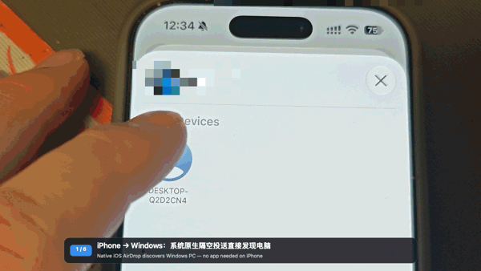

<p align="center">
  
</p>

<h1 align="center">nekodrop</h1>

<p align="center">
  <b>用笔记本自带的 Intel 网卡在 Windows 上收发 AirDrop，Wi-Fi 照常上网。</b><br>
  不需要 USB 网卡，不需要 Linux 虚拟机，也不需要 Mac。
</p>

<p align="center">
  <a href="README.md">English</a> · 简体中文
</p>

<p align="center">
  
  
  
  
</p>

<p align="center">
  
  <br>
  <sub>
    <b>实机拍摄（未装任何第三方 App 的 iPhone ↔ Windows 11，自带 Intel AX201 在 5 GHz 信道 44 同卡保持 Wi-Fi 在线）：</b><br>
    ① iPhone 原生隔空投送直接发现电脑并发图 → ② Windows 保持 Wi-Fi 在线同时点击接收 → ③ 3556×2000 原图无损保存打开 → ④ 资源管理器右键 <i>Send with nekodrop</i> → ⑤ 选中附近 iPhone 发出 → ⑥ iPhone 灵动岛原生弹窗收图并打开。
  </sub>
</p>

---

## 功能

- **接收 iPhone、iPad、Mac 发来的文件**：电脑会像苹果设备一样出现在 AirDrop 列表里。文件存到你指定的文件夹（默认 `下载\nekodrop`），每次传输都可以在通知里选择接受或拒绝。
- **发送到苹果设备**：在资源管理器里右键文件，选 **用 nekodrop 发送**（Windows 11 第一级菜单、经典菜单和“发送到”里都有），再选附近的设备。
- **AirDrop 时照常上网**：在“同时联网和 AirDrop”模式下，nekodrop 自己驱动网卡，一个虚拟接口连你的 Wi-Fi，另一个跑 AWDL（苹果无线直连协议）。Windows 里上网走一块名叫 **nekodrop** 的“有线网卡”。
- **完整的 Wi-Fi 管理**：扫描、连接、隐藏网络、已保存网络和自动连接。会导入 Windows 里已保存的 Wi-Fi，还能识别酒店、机场、校园网这类需要网页登录的网络，并自动在浏览器里打开登录页。
- **自动恢复**：后台服务盯着 radio、AWDL 守护进程和 AirDrop 引擎，哪个停了就重启哪个。开机自动启动。
- **托盘程序**：中英双语，浅色界面，有系统通知和设置窗口。

## 实机测试

以下都是作者在自己的笔记本上实际测过的，不是纸上谈兵：

| | |
|---|---|
| 网卡 | **Intel Wi-Fi 6 AX201 160MHz**（CNVi，固件 `iwlwifi-QuZ-a0-hr-b0-68`） |
| 系统 | Windows 11 专业版 x64 |
| iPhone → Windows | ✅ 可用：照片和文件完整收到 |
| Windows → iPhone | ✅ 可用：右键 → 用 nekodrop 发送，iPhone 接受并收到 |
| 同时上网 | ✅ 可用：AirDrop 运行时电脑通过 nekodrop 自己的 WPA2 连接保持在线，Wi-Fi 和 AWDL 在同一个 5 GHz 信道上也没问题 |
| AirDrop 运行时的网速 | 下载峰值约 **28 Mbps**（每秒约 2,370 个包，持续 20 秒；5 GHz 信道 44，80 MHz，WPA2）。这是按 radio 的收包计数、假设每个包都是 1,500 字节满包估算的，取自日常使用而不是测速，链路的真实上限可能更高。测得时 Block Ack 处于拒绝状态（0.1.1 起的默认设置）；开着 Block Ack 时见到的峰值约 22 Mbps |

其他 AX201 笔记本用的是同一颗芯片、同一份固件，应该表现一致，但目前只在这一台上测过。欢迎在 [Issues](../../issues) 反馈其他机器的结果。

## 支持的网卡

nekodrop 直接驱动网卡芯片，只有写了驱动的芯片才能用。上游驱动（[ForbiddenItlwm](https://github.com/retropineaple/ForbiddenItlwm) 的 `hal_iwx`）带了固件的网卡都已支持。作者用 AX201 测试；AX200、AX210、AX211 已有用户反馈双向 AirDrop 可用（见下表链接），其余网卡照上游移植，未经测试。

| 网卡 | PCI ID（`8086:`） | 固件 | 状态 |
|---|---|---|---|
| **Intel Wi-Fi 6 AX201** 160 MHz（CNVi） | `02F0` `06F0` `34F0` `3DF0` `4DF0` `43F0` `A0F0` | `Qu/QuZ-hr-b0-68` | ✅ **已实测**（`43F0` 上的 QuZ） |
| Qu/QuZ 上的 Intel Wireless-AC 9560 / 9462 / 9461（CNVi） | 与 AX201 相同 | `Qu/QuZ-jf-b0-68` | ⚠️ 未测试 |
| Intel Wi-Fi 6 AX200（独立网卡） | `2723` | `cc-a0-68` | ✅ 用户反馈双向 AirDrop 可用（[#1](../../issues/1)、[#4](../../issues/4)） |
| Intel Wi-Fi 6E AX210（独立网卡） | `2725` | `ty-a0-gf-a0-68` + PNVM | ✅ 用户反馈双向 AirDrop 可用（[#14](../../issues/14)、[#18](../../issues/18)）；部分机器仍在修（[#11](../../issues/11)） |
| Intel Wi-Fi 6E AX211（CNVi，第 12 代及以后） | `7AF0` `7A70` `51F0` `51F1` `54F0` `7F70` | `so-a0-gf-a0-68` + PNVM | ✅ 用户反馈双向 AirDrop 可用（[#9](../../issues/9)）；部分机器发现设备还不稳定（[#16](../../issues/16)） |
| Intel Wi-Fi 6E AX411 / Killer AX1690（CNVi） | 与 AX211 相同 | `so-a0-gf4-a0-68` + PNVM | ⚠️ 未测试（[#7](../../issues/7)） |
| So 平台上的 Intel Wi-Fi 6 AX203 / 9560 | 与 AX211 相同 | `so-a0-hr/jf-b0-68` | ⚠️ 未测试 |
| Intel SnJ `2726`、QnJ `2720`、Meteor Lake `7E40`/`2729` | | 上游没有固件 | ❌ |
| Intel BE200 / BE201（Wi-Fi 7） | | 上游没有驱动 | ❌ |
| Realtek、MediaTek、高通、博通 | | | ❌ |

怎么看自己的网卡：打开 *设备管理器 → 网络适配器*。不在上表里的网卡，安装程序会直接拒绝安装。在未测试的网卡上，nekodrop 可能启动不了固件；这时网卡不会坏，运行下面的**一键回退**即可，也欢迎在 [Issues](../../issues) 附上日志反馈。

不确定自己是什么网卡，或者希望支持别的网卡？[诊断报告](#反馈问题诊断报告)不装 nekodrop 也能用：下载 [`installer/report.ps1`](installer/report.ps1)，运行 `powershell -ExecutionPolicy Bypass -File report.ps1`。它会列出每块无线网卡的 PCI ID、芯片、驱动，以及 nekodrop 为什么能或不能在上面运行；欢迎贴到 [Issues](../../issues)。**Realtek RTL8852CE**（`10EC:C852`）现在就可以用上游的 [winawdl](https://github.com/raph559/winawdl)（只有 AirDrop，不能同时连 Wi-Fi）。支持其他网卡需要做什么，见 [docs/HARDWARE.md](docs/HARDWARE.md)（英文）。

### 出问题了？一键回退

开始菜单 → **nekodrop - restore Windows Wi-Fi**（或双击 `C:\Program Files\nekodrop` 里的 `restore.cmd`）。它会停掉 nekodrop，把网卡还给 Intel 驱动，删除 nekodrop 的驱动包，恢复 Windows 自带的 Wi-Fi，不管 nekodrop 把网卡留在什么状态。nekodrop 本身不会被卸载，想再用时重新运行安装程序即可。日志：`C:\ProgramData\nekodrop\restore.log`。

### 反馈问题：诊断报告

日志是我们修问题的依据，尤其是我们手上没有的网卡。提 [Issue](../../issues) 时请务必附上。

1. 开始菜单 → **nekodrop - diagnostic report**（或托盘图标 → **生成诊断报告…**，或主窗口底部的 **诊断报告**）。会弹出管理员权限提示，请允许，因为日志和驱动状态只有管理员能读。
2. 桌面上会生成两个文件，报告会用记事本打开：
   - `nekodrop-report-<时间>.md`：摘要、最近一次 radio 启动的逐步检查（驱动绑定 → 固件 → PNVM → 初始化 → 就绪）、系统、网卡、驱动、网络和蓝牙信息、发现设备的时间线，以及关键日志行。它也已经复制到剪贴板，**直接粘贴到 issue 里**即可。
   - `nekodrop-logs-<时间>.txt`：完整日志，**拖进 issue 作为附件**。
3. SSID、MAC 地址、内网 IP、用户名和电脑名都会替换成 `<SSID-1>`、`<MAC-2>` 这样的占位符，不会上传任何东西。发出前请先看一眼报告内容。

**旧版本没有这个入口时**，可以下载 [`installer/report.ps1`](installer/report.ps1)，在命令提示符里运行：`powershell -ExecutionPolicy Bypass -File report.ps1`。也可以手动收集日志：

| 文件 | 内容 |
|---|---|
| `C:\ProgramData\nekodrop\service.log`（以及 `service.log.1`） | 服务、radio（固件、AWDL、Wi-Fi）和 awdld 的日志，需要管理员权限才能读 |
| `%LocalAppData%\nekodrop\engine.log`（以及 `engine.log.old`） | AirDrop 引擎：发现设备、蓝牙信标、收发文件 |
| `C:\ProgramData\nekodrop\install.log` | 安装过程：驱动、TAP 网卡、防火墙、服务 |
| `C:\ProgramData\nekodrop\restore.log` | 一键回退 |

## 系统要求

- Windows 10 2004（版本 19041）或更新的 64 位系统（Windows 10 22H2 在 0.1.16 及以上已确认双向可用，[#18](../../issues/18)）。
- 受支持的 Intel 网卡（见上表）。
- 安装需要管理员权限。
- 发送文件需要蓝牙：AirDrop 用蓝牙低功耗信标唤醒附近的苹果设备。
- 苹果设备那边把 AirDrop 设为 **所有人（10 分钟）**。“仅限联系人”需要 Apple ID 证书，nekodrop 没有。

## 安装

1. 从 [Releases](../../releases) 下载 `nekodrop-<版本>-setup.exe` 并运行。
2. 安装程序会：
   - 把文件复制到 `C:\Program Files\nekodrop`；
   - **在你的电脑上**生成一个代码签名证书，用它给小小的寄存器代理驱动签名并信任它，然后**删除私钥**，这个证书以后再也签不了别的东西；
   - 创建名为 **nekodrop** 的 TAP 虚拟网卡（TAP-Windows，OpenVPN 签名）；
   - 添加两条只允许链路本地地址的入站防火墙规则（TCP 8771-8779、UDP 5353）；
   - 安装并启动 **NekoDropService** 服务。
3. 托盘里会出现紫色小猫图标。打开它，确认 **允许接收** 已勾选。

第一次启动时，nekodrop 会从 Intel 驱动手里接管网卡，并自动连回 Windows 原来连着的网络。之后 Windows 自带的 Wi-Fi 图标会消失，改用 nekodrop 托盘菜单里的 **Wi-Fi…** 窗口管理网络。

### 更新

nekodrop 启动一分钟后检查 GitHub 上有没有新版本，之后每 6 小时检查一次。发现新版本会弹通知，点 **更新** 就会下载安装包，先核对 GitHub 公布的 SHA-256，再运行安装（Windows 会请求管理员权限）。不会在你不知情时自己安装。*设置 → 更新* 里可以关闭自动检查、选择是否包括预览版，也可以手动 **检查更新**。目前所有版本都是预览版。

### 卸载

在 *设置 → 应用 → nekodrop → 卸载*，或者运行安装目录里的 `uninstall.ps1`。卸载时会先把网卡还给 Intel 驱动，再删除服务、驱动包、证书信任和防火墙规则。

## 使用

| 想做什么 | 怎么做 |
|---|---|
| 接收 | 保持 **允许接收** 勾选。在 iPhone 上点 分享 → AirDrop，选你电脑的名字 |
| 发送 | 右键文件 → **用 nekodrop 发送** → 选设备；也可以把文件拖到主窗口 |
| 换 Wi-Fi | 托盘 → **Wi-Fi…**，选网络、输入密码、点连接 |
| 连隐藏网络 | **Wi-Fi…** → *隐藏网络*，输入网络名和密码 |
| 酒店 Wi-Fi 登录 | 直接连接，登录页会自动在浏览器里打开 |
| 把网卡还给 Windows | 托盘 → *联网方式* → **按需接管网卡** 或 **关闭 AirDrop** |
| 改设备名、保存位置、语言 | 托盘 → **设置…** |

### 联网方式

| 模式 | 上网 | AirDrop |
|---|---|---|
| **同时联网和 AirDrop**（默认） | 走 nekodrop 自己的 Wi-Fi 连接（“nekodrop”网卡） | 一直可用 |
| **按需接管网卡** | 正常的 Intel 驱动 | 附近 iPhone 打开 AirDrop 或你发送文件时才接管网卡，传输期间会断网 |
| **关闭 AirDrop** | 正常的 Intel 驱动 | 关闭 |

### 支持的 Wi-Fi 加密

| 网络类型 | 同时模式下 |
|---|---|
| 开放网络 | ✅ |
| WPA/WPA2 个人版 | ✅ |
| WPA2/WPA3 混合 | ✅（用 WPA2 连接） |
| 要求管理帧保护的 WPA2、WPA2-PSK-SHA256 | 🧪 0.1.12，未实机测试 |
| 需要网页登录的网络 | ✅ 自动识别并打开登录页 |
| 隐藏网络 | ✅ |
| 纯 WPA3 个人版（SAE） | 🧪 0.1.12，未实机测试（只接受 hash-to-element 的网络暂不支持，多见于 6 GHz） |
| 增强型开放（OWE） | 🧪 0.1.12，未实机测试 |
| WPA2/WPA3 企业版（802.1X、PEAP 等） | ❌ 暂不支持，会自动改用“按需”模式 |
| WEP、WPA/TKIP | ❌（不安全，不计划支持） |

### 实验性功能

在 *设置 → 实验性功能* 里。两个开关**默认都关闭**，关闭时 nekodrop 的行为和没有这两个功能时完全一样。打开或关闭时 AirDrop 会重启几秒。之所以标成实验性，是因为还没在足够多的硬件上确认过：如果发送变差了就关掉。不管效果好坏，都欢迎在 [Issues](../../issues) 附诊断报告反馈。

**更快发送到 iPhone**（0.1.9 起）
- 同时在途的 AWDL 帧从 8 个提高到 48 个，每批数据只敲一次网卡门铃，速率阶梯从高一档（HT MCS 4）起步。
- 对每帧往返时间成为瓶颈的情况有帮助。目前的实测：AX200 上和默认一样，约 1.3 MB/s（[#4](../../issues/4)）；AX210 上略快（[#14](../../issues/14)）。

**聚合发送（A-MPDU）**（0.1.15 起，尚未实机测试）

发给 iPhone 慢（约 1.3 MB/s），从 iPhone 收却快（约 9 MB/s）。原因是我们发的每一帧都单独发出、单独等确认，而且只能在 iPhone 正好停在我们信道上的时候发；iPhone 那边会把多帧聚合起来，所以接收快。这个开关照 ForbiddenItlwm 的做法（它的 `-itlawdlcoexbatx`，在 Mac 上 Mac → iPhone 约 22 MB/s）让我们这边也聚合：
1. 开始给某台 iPhone 发大文件时（每秒约 200 个满长度帧），给这台 iPhone 单独建一个固件站点，配一条聚合发送队列，并打开固件的速率控制（VHT 80 MHz，网卡支持时用双流）。
2. 向 iPhone 请求 Block Ack 会话（ADDBA）：iPhone 在我们信道上时每 200 毫秒问一次，最多 40 次，然后休息 20 秒再试。
3. iPhone 同意后，这次传输的帧改成 TID 0 的 QoS 数据帧，由固件打包成 A-MPDU 发出。建立连接这类短交互仍走原来的路径，保留原有的重传。
4. 从 iPhone 的 AWDL 同步帧跟踪它的时间表：16 个时隙里哪些在我们信道上、每个从什么时候开始。iPhone 不在时，暂停固件里它的队列，免得白白重传；发给它的其他帧也先等着，最多等到它回来。
5. iPhone 的站点存在期间关闭混杂接收，这样固件会确认 iPhone 发来的帧。

测试时看这几处：
- 诊断报告多一行 **A-MPDU sending**，显示 `agreed` 说明 iPhone 接受了 Block Ack。
- service 日志每 5 秒一行 `aggregate:`。其中 *Block Acks* 和 *largest* 能看出固件是否真的在聚合发送（每个 Block Ack 对应多帧），*pauses* 能看出按时间表暂停是否在工作。
- 如果一直是 `asking`，说明 iPhone 没回应我们的 ADDBA，上游也遇到过，请附上报告。

DMA 内存不够分配额外的发送环，或者走的是内核驱动路径时，这个开关不起作用，发送方式和原来一样。

## 进度

| 部分 | 状态 |
|---|---|
| 用户态 Intel 驱动：固件启动、监听、注入、扫描 | ✅ AX201、AX200、AX210、AX211 上可用（后三者为用户反馈） |
| iPhone → Windows | ✅ 可用（收到的照片完整，哈希一致） |
| Windows → iPhone | ✅ 可用（AX201 实测；AX200、AX210、AX211 用户反馈可用） |
| 联网同时 AirDrop | ✅ 可用（WPA2、DHCP、DNS 都走“nekodrop”网卡） |
| Wi-Fi 管理、已保存网络、网页登录识别 | ✅ |
| 服务、托盘程序、通知、右键菜单、安装包 | ✅ |
| 纯 WPA3、OWE | 🧪 0.1.12，未实机测试 |
| 802.1X（企业版） | ⏳ 计划中 |
| AX200、AX210、AX211 | ✅ 用户反馈双向 AirDrop 可用 |
| AX411、Qu/So 上的 9560、AX203 | 🧪 已照上游移植，未实机测试 |
| Windows 10 | ✅ 用户反馈 0.1.16 及以上双向 AirDrop 可用（[#18](../../issues/18)） |
| 内核 WiFiCx 驱动（`kdriver/`） | 🧊 已搁置：实验性，安装包**不会安装**它，见 [docs/KERNEL.md](docs/KERNEL.md) |

## 工作原理

```
 nekodrop.exe（托盘程序，用户会话）──JSON 管道──► NekoDropService（SYSTEM）
   │  AirDrop 引擎（Python）                        │ 接管 / 归还网卡
   │  通知 · 右键菜单 · 发送窗口                       │ Wi-Fi 管理、看门狗
   │                                                ▼
   └── awdl0（Wintun，IPv6）◄── awdld（AWDL，OWL）◄─管道─ nekodrop-radio（用户态 Intel 驱动）
                                                         ├ MAC 0：AWDL，信道 6/44/149
     “nekodrop” TAP 网卡 ◄── 以太网桥接 ◄─────────────────┤ MAC 1：站点模式，连你的路由器
     （Windows 上网用）                                   └ UMDF 寄存器代理 + 用户态 DMA → AX201
```

1. **寄存器代理**：一个很小的 UMDF 驱动（`driver/regproxy`）代替 Intel 驱动绑定 AX201。它只负责把网卡寄存器和中断映射给一个用户态进程，我们自己的代码不在内核里运行。
2. **用户态驱动**：`nekodrop-radio`（`iwxradio/`）是把 OpenBSD/itlwm 的 `iwx` 驱动移植到用户态。它通过用户态 DMA 加载 Intel 固件，然后同时跑两个 MAC：一个监听和注入 AWDL 帧，另一个是普通的 Wi-Fi 站点，支持 WPA2（四次握手、密钥交给固件、速率控制）。
3. **AWDL**：`awdld`（OWL，Open Wireless Link）通过 radio 管道实现苹果的 AWDL 协议，把链路做成 IPv6 网卡 `awdl0`。
4. **AirDrop**：Python 引擎在 `awdl0` 上实现 AirDrop：mDNS 发现，8771 端口上的 HTTPS（8772-8779 备用），`/Discover`、`/Ask`、`/Upload` 流程，以及发送时用的蓝牙信标。
5. **上网**：站点 MAC 收发的帧桥接到“nekodrop” TAP 网卡，Windows 把它当成以太网，用 DHCP 拿地址。

设计细节：[docs/DESIGN.md](docs/DESIGN.md)（驱动、DMA、风险）· [docs/CLIENT.md](docs/CLIENT.md)（服务、客户端、联网模式）。

## 常见问题

| 现象 | 试试 |
|---|---|
| iPhone 搜不到电脑 | 把 iPhone 的 AirDrop 设为“所有人（10 分钟）”，关掉再打开（清掉缓存的旧记录），手机解锁并放在附近 |
| iPhone 上出现两个电脑 | 之前运行留下的缓存记录，在 iPhone 上把 AirDrop 关掉再打开 |
| 没网 | 托盘 → **Wi-Fi…**，确认已连接。网络可能需要网页登录，或者是纯 WPA3 / 企业网（见上表） |
| Windows 的 Wi-Fi 图标没了 | 同时模式下是正常的：网卡归 nekodrop 管。用 **Wi-Fi…**，或者切到“按需” |
| 其他问题 | 提 [Issue](../../issues)，并附上[诊断报告](#反馈问题诊断报告) |

## 从源码构建

需要 Visual Studio 2022 Build Tools（C++、Windows SDK、CMake）、.NET 8 SDK 和 Git。Inno Setup 6 可选，没装就输出 zip。不用装 WDK，脚本会用它的 NuGet 包。

```powershell
git clone https://github.com/zheznanohana/nekodrop.git
cd nekodrop
.\scripts\fetch-deps.ps1        # 下载 winawdl、ForbiddenItlwm（固件）、MinGW、WDK NuGet 到 third_party\
.\scripts\build-installer.ps1   # 全部构建 → build\nekodrop-0.1.8-setup.exe
.\scripts\build-radio.ps1       # 只构建用户态驱动并跑离线自检
```

| 目录 | 内容 |
|---|---|
| `iwxradio/` | 用户态 Intel 驱动（C++）：固件、AWDL 监听/注入、站点模式、WPA2、UMAC 扫描 |
| `driver/regproxy/` | UMDF 寄存器代理驱动 |
| `app/service/` | NekoDropService（C#）：网卡接管、radio 监管、Wi-Fi 管理 |
| `app/client/` | 托盘程序（C# WPF）：界面、通知、运行 AirDrop 引擎 |
| `app/shellext/` | Windows 11 右键菜单 |
| `installer/` | Inno Setup 脚本、安装/卸载脚本、TAP 配置 |
| `kdriver/` | 已搁置的内核 WiFiCx 驱动（实验性，不随安装包发布） |

## nekodrop 是怎么开发的

从 0.1.17 起，nekodrop 由 AI 代理全自动开发，没有人工参与。每小时一轮：
1. **维护**：Claude 读新 issue 和诊断报告，修复日志能证实的问题，在 GitHub Actions 上测试，发预览版并回复反馈者。
2. **进化**：在 AI Hub 工作台里，Gemini 4 Neon High 当产品经理，提出一项改进，可以是修 bug、加强诊断、提速，或者朝支持更多硬件迈出第一步。Claude 在隔离的 git worktree 里实现，Codex 做 QA 审查，不通过最多打回三次。

没有人审批，由固定的规则把关：
- 只有通过编译、radio 自检、诊断报告测试、引擎测试，并且 QA 通过的改动才会合并。
- 合并的改动都会自动发布为**预览版**。代理优先做**低风险**改动（文档、诊断、客户端界面）和**实验性**改动（新行为挂在默认关闭的开关后，原有代码路径不变）。
- **高风险**改动（默认行为、驱动 INF、安装和回退脚本、权限、CI、依赖版本）发版前会多做一轮独立复审。
- **回滚**：如果反馈显示新版本弄坏了原本能用的功能，下一轮会先撤销那个改动并发版，再做新的事。
- 每个版本的发布说明都会写明哪些没在真机上测过。

短板是这些代理手上没有 Intel 网卡可测，改动有没有效果，全靠用户的诊断报告告诉它们。所以请继续[反馈](../../issues/10)。

## 代码来源

nekodrop 是在其他开源项目的基础上做的。这里写清楚哪些是**直接用了源码**（复制、移植或打包），哪些只是**参考**。

### 用到的源码

| 项目 | 许可 | 用了什么 | 在 nekodrop 里的位置 |
|---|---|---|---|
| [retropineaple/ForbiddenItlwm](https://github.com/retropineaple/ForbiddenItlwm) 0.6.0（itlwm 分支，macOS） | GPL-2.0 | Intel 22000 系列驱动 `hal_iwx`：固件加载、TLV 解析、context info、收发环、固件命令、寄存器头文件 `if_iwxreg.h`。还有它的 AWDL 策略：信道跟随（44/149 的 min 规则、国家码学习）、接收 Block Ack、BA 期间关混杂、速率阶梯、主机侧单播重发、信标提示 | `iwxradio/`，从内核 C 移植成用户态 C++ 驱动 |
| ForbiddenItlwm 的固件目录 | Intel 再分发许可 | iwlwifi 固件 `iwlwifi-Qu*-hr-b0-68.ucode` | 随安装包放在 `radio\firmware\` |
| [raph559/winawdl](https://github.com/raph559/winawdl) | MIT | 在 Windows 上从用户态接管 PCIe 网卡的方法：UMDF 寄存器代理驱动（原本给 Realtek RTL8852CE 用）和用户态 DMA；radio 管道协议 | `driver/regproxy/`（改成 AX201 的 PCI ID）、`iwxradio/`（管道和 DMA） |
| winawdl 的 `awdl/`（`awdld`） | GPL-3.0 或更新（基于 OWL） | AWDL 守护进程：OWL 的协议核心加上 Windows I/O 层和 Wintun | 从源码编译，随安装包放在 `awdl\awdld.exe` |
| winawdl 的 `airdrop/` | MIT | Python 写的 AirDrop 引擎：mDNS、HTTPS 接收端、发送端、蓝牙信标 | 放在 `airdrop\`，打了两个小补丁（`scripts/patch-engine.py`：固定实例名、备用端口） |
| [seemoo-lab/owl](https://github.com/seemoo-lab/owl) | GPL-3.0 | `awdld` 里的 AWDL 实现 | 经由 winawdl |
| [Wintun](https://www.wintun.net/) | Wintun 许可 | 虚拟网卡 `awdl0` | `awdl\wintun.dll`（预编译） |
| [TAP-Windows6](https://github.com/OpenVPN/tap-windows6) | GPL-2.0 / OpenVPN | Windows 上网用的“nekodrop”虚拟以太网卡 | 安装时装上（OpenVPN 签名的安装程序） |

### 参考过的项目（没有复制代码）

| 项目 | 参考了什么 |
|---|---|
| OpenBSD `iwx(4)`、Linux `iwlwifi` | 固件、UMAC 扫描、站点模式、密钥的工作方式 |
| [seemoo-lab/opendrop](https://github.com/seemoo-lab/opendrop) | AirDrop 协议（`/Discover`、`/Ask`、`/Upload`、mDNS 记录） |
| [microsoft/Windows-driver-samples](https://github.com/microsoft/Windows-driver-samples) | 已搁置的内核驱动（`kdriver/`）的 WiFiCx 结构 |
| [t4t5/owly](https://github.com/t4t5/owly)、[JungyoKim/WirDrop](https://github.com/JungyoKim/WirDrop) | 其他平台上实现 AirDrop 的尝试，设计时对比参考 |

### nekodrop 自己写的部分

- `iwxradio/`：用户态移植本身，以及所有 Windows 特有的部分：两个 MAC 同时运行（AWDL 监听加上独立 PHY 上的 Wi-Fi 站点）、WPA2 站点模式（四次握手、密钥交给固件、TLC 速率控制）、TAP 桥接、固件 UMAC 扫描、信标解析和加密方式识别。
- `app/service/`：Windows 服务：网卡接管、radio 和 awdld 监管、Wi-Fi 管理（DPAPI 加密保存的网络、自动连接、隐藏网络、网页登录识别）。
- `app/client/`：托盘程序（WPF）、通知、发送窗口、Wi-Fi 窗口、中英文界面。
- `app/shellext/`：Windows 11 右键菜单。
- `installer/`：Inno Setup 安装包、本机驱动签名、TAP 配置和卸载。

## 贡献者

感谢提交代码和细致测试报告的各位：

- [@BaiBaiAi](https://github.com/BaiBaiAi)：Windows → iPhone 发送不再出示客户端证书（[#13](../../pull/13)）、AWDL 发送流水线化让大文件能传完（[#15](../../pull/15)），以及第一份 AX210 实测报告（[#14](../../issues/14)）。

## 许可

nekodrop 整体以 **GPL-2.0** 发布（见 [LICENSE](LICENSE)），因为 `iwxradio/` 派生自 itlwm/ForbiddenItlwm。

- `if_iwxreg.h`：BSD/GPL-2.0 双许可。
- `driver/regproxy` 和 AirDrop 引擎：沿用 winawdl 的 MIT 许可。
- `awdld`：GPL-3.0 或更新，来自 winawdl/OWL，是通过管道通信的独立程序。
- iwlwifi 固件：Intel 再分发许可（`licenses\iwlwifi-firmware.txt`）。
- Wintun 和 TAP-Windows：各按其许可。

安装包会把所有许可证复制到 `licenses\`。

## 社区友链

- [LINUX DO](https://linux.do/) — 新的理想型社区

## 免责声明

nekodrop 是独立项目，与 Apple、Intel 没有任何关系，也未获得它们的认可。AirDrop、iPhone、iPad、Mac 是 Apple Inc. 的商标，Intel 是 Intel Corporation 的商标。nekodrop 运行期间会替换你的 Wi-Fi 驱动。这是实验性软件，按原样提供，不附带任何担保。
